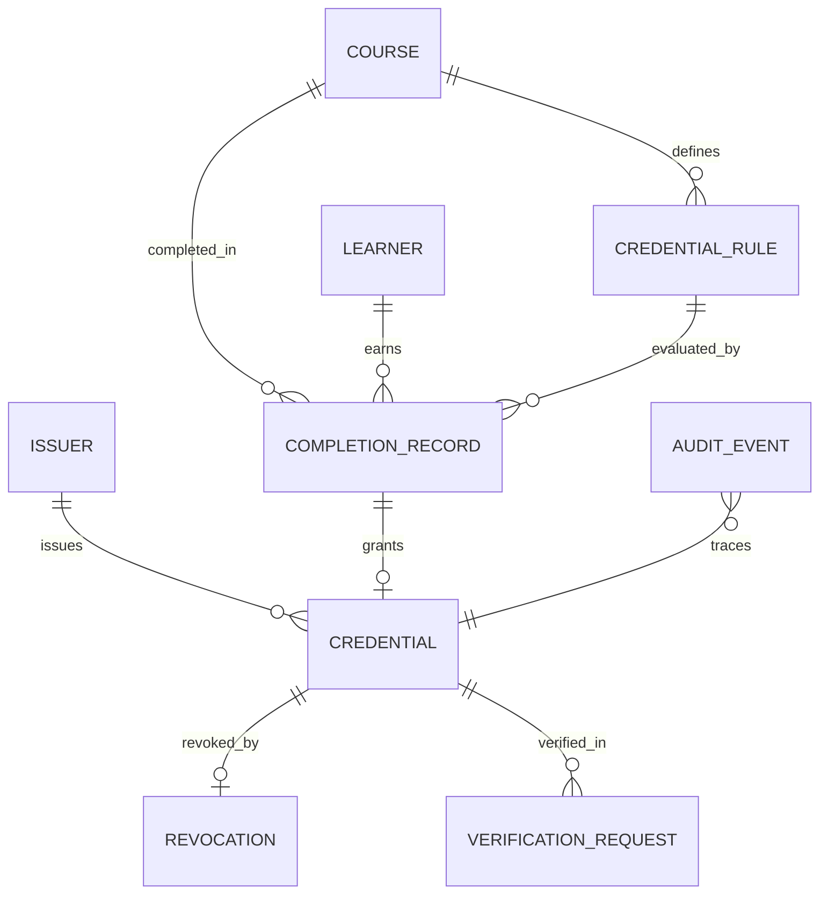

# Relational Data Model & Database Architecture

**Feature**: `specs/001-credential-lifecycle-system`  
**Database Engine**: PostgreSQL 15+  
**ORM**: SQLAlchemy 2.0+ (Declarative Async/Sync)  
**Migration Tool**: Alembic  

---

## 1. Entity-Relationship Diagram



---

## 2. Table Specifications & Constraints

### 2.1 `issuers`
Stores authorized institutions and organizations permitted to issue digital credentials.
```sql
CREATE TABLE issuers (
    id SERIAL PRIMARY KEY,
    public_id VARCHAR(32) NOT NULL UNIQUE, -- ISS-XXXXX
    name VARCHAR(255) NOT NULL,
    public_key_pem TEXT NOT NULL,          -- Ed25519 Public Key
    status VARCHAR(32) NOT NULL DEFAULT 'ACTIVE', -- ACTIVE, SUSPENDED, RETIRED
    created_at TIMESTAMPTZ NOT NULL DEFAULT CURRENT_TIMESTAMP,
    CONSTRAINT chk_issuer_status CHECK (status IN ('ACTIVE', 'SUSPENDED', 'RETIRED'))
);
CREATE INDEX idx_issuers_public_id ON issuers(public_id);
```

### 2.2 `courses`
Stores academic courses or curriculum modules.
```sql
CREATE TABLE courses (
    id SERIAL PRIMARY KEY,
    public_id VARCHAR(32) NOT NULL UNIQUE, -- CRS-XXXXX
    title VARCHAR(255) NOT NULL,
    version VARCHAR(32) NOT NULL DEFAULT '1.0',
    status VARCHAR(32) NOT NULL DEFAULT 'ACTIVE',
    created_at TIMESTAMPTZ NOT NULL DEFAULT CURRENT_TIMESTAMP,
    CONSTRAINT chk_course_status CHECK (status IN ('ACTIVE', 'ARCHIVED'))
);
CREATE INDEX idx_courses_public_id ON courses(public_id);
```

### 2.3 `credential_rules`
Defines eligibility policy required for credential granting.
```sql
CREATE TABLE credential_rules (
    id SERIAL PRIMARY KEY,
    course_id INTEGER NOT NULL REFERENCES courses(id) ON DELETE RESTRICT,
    rule_version VARCHAR(32) NOT NULL DEFAULT '1.0',
    min_score NUMERIC(5, 2) NOT NULL DEFAULT 80.00,
    required_completion_status VARCHAR(32) NOT NULL DEFAULT 'COMPLETED',
    effective_from TIMESTAMPTZ NOT NULL,
    effective_to TIMESTAMPTZ NOT NULL,
    active BOOLEAN NOT NULL DEFAULT TRUE,
    created_at TIMESTAMPTZ NOT NULL DEFAULT CURRENT_TIMESTAMP,
    CONSTRAINT chk_rule_dates CHECK (effective_to > effective_from),
    CONSTRAINT chk_min_score CHECK (min_score >= 0.00 AND min_score <= 100.00)
);
CREATE INDEX idx_rules_course ON credential_rules(course_id);
```

### 2.4 `learners`
Stores recipient student master data. Names may repeat; public IDs are immutable and unique.
```sql
CREATE TABLE learners (
    id SERIAL PRIMARY KEY,
    public_id VARCHAR(32) NOT NULL UNIQUE, -- LRN-XXXXX
    full_name VARCHAR(255) NOT NULL,
    email VARCHAR(255) NOT NULL UNIQUE,
    status VARCHAR(32) NOT NULL DEFAULT 'ACTIVE',
    created_at TIMESTAMPTZ NOT NULL DEFAULT CURRENT_TIMESTAMP,
    CONSTRAINT chk_learner_status CHECK (status IN ('ACTIVE', 'SUSPENDED'))
);
CREATE INDEX idx_learners_public_id ON learners(public_id);
```

### 2.5 `completion_records`
Stores academic completion evidence and assessment scores.
```sql
CREATE TABLE completion_records (
    id SERIAL PRIMARY KEY,
    learner_id INTEGER NOT NULL REFERENCES learners(id) ON DELETE RESTRICT,
    course_id INTEGER NOT NULL REFERENCES courses(id) ON DELETE RESTRICT,
    rule_id INTEGER NOT NULL REFERENCES credential_rules(id) ON DELETE RESTRICT,
    assessment_score NUMERIC(5, 2) NOT NULL,
    status VARCHAR(32) NOT NULL, -- COMPLETED, IN_PROGRESS, FAILED
    completion_timestamp TIMESTAMPTZ NOT NULL,
    created_at TIMESTAMPTZ NOT NULL DEFAULT CURRENT_TIMESTAMP,
    CONSTRAINT chk_assessment_score CHECK (assessment_score >= 0.00 AND assessment_score <= 100.00),
    CONSTRAINT chk_completion_status CHECK (status IN ('COMPLETED', 'IN_PROGRESS', 'FAILED'))
);
CREATE INDEX idx_completions_learner ON completion_records(learner_id);
CREATE INDEX idx_completions_course ON completion_records(course_id);
```

### 2.6 `credentials`
Represents an issued digital credential with cryptographic integrity metadata.
```sql
CREATE TABLE credentials (
    id SERIAL PRIMARY KEY,
    public_id VARCHAR(64) NOT NULL UNIQUE, -- CRED-YYYY-XXXXX
    completion_id INTEGER NOT NULL UNIQUE REFERENCES completion_records(id) ON DELETE RESTRICT,
    issuer_id INTEGER NOT NULL REFERENCES issuers(id) ON DELETE RESTRICT,
    issued_at TIMESTAMPTZ NOT NULL,
    canonical_payload_hash VARCHAR(64) NOT NULL, -- SHA-256
    issuer_signature TEXT NOT NULL,              -- Cryptographic signature
    payload_snapshot JSONB NOT NULL,             -- Frozen claims at issuance
    status VARCHAR(32) NOT NULL DEFAULT 'ACTIVE',-- ACTIVE, REVOKED
    created_at TIMESTAMPTZ NOT NULL DEFAULT CURRENT_TIMESTAMP,
    CONSTRAINT chk_cred_status CHECK (status IN ('ACTIVE', 'REVOKED'))
);
CREATE INDEX idx_credentials_public_id ON credentials(public_id);
CREATE INDEX idx_credentials_issuer ON credentials(issuer_id);
```

### 2.7 `revocations`
Stores authorized revocations. Preserves history without mutating issuance tables.
```sql
CREATE TABLE revocations (
    id SERIAL PRIMARY KEY,
    credential_id INTEGER NOT NULL UNIQUE REFERENCES credentials(id) ON DELETE RESTRICT,
    revoked_by_actor_id VARCHAR(64) NOT NULL,
    reason_code VARCHAR(64) NOT NULL,            -- ACADEMIC_MISCONDUCT, ADMINISTRATIVE_ERROR, RESCINDED
    revocation_timestamp TIMESTAMPTZ NOT NULL DEFAULT CURRENT_TIMESTAMP,
    notes TEXT,
    created_at TIMESTAMPTZ NOT NULL DEFAULT CURRENT_TIMESTAMP,
    CONSTRAINT chk_revocation_reason CHECK (reason_code IN ('ACADEMIC_MISCONDUCT', 'ADMINISTRATIVE_ERROR', 'RESCINDED', 'OTHER'))
);
CREATE INDEX idx_revocations_credential ON revocations(credential_id);
```

### 2.8 `verification_requests`
Audit log of all third-party verification queries.
```sql
CREATE TABLE verification_requests (
    id SERIAL PRIMARY KEY,
    public_id VARCHAR(32) NOT NULL UNIQUE,       -- VRF-XXXXX
    credential_id INTEGER REFERENCES credentials(id) ON DELETE SET NULL,
    requested_identifier VARCHAR(128) NOT NULL,
    verification_timestamp TIMESTAMPTZ NOT NULL DEFAULT CURRENT_TIMESTAMP,
    outcome VARCHAR(32) NOT NULL,                -- VALID, REVOKED, TAMPERED, NOT_FOUND, INVALID_ISSUANCE
    reason_code VARCHAR(64) NOT NULL,
    integrity_check_passed BOOLEAN NOT NULL,
    issuer_authenticated BOOLEAN NOT NULL,
    requester_ip VARCHAR(64),
    created_at TIMESTAMPTZ NOT NULL DEFAULT CURRENT_TIMESTAMP,
    CONSTRAINT chk_verif_outcome CHECK (outcome IN ('VALID', 'REVOKED', 'TAMPERED', 'NOT_FOUND', 'INVALID_ISSUANCE'))
);
CREATE INDEX idx_verif_credential ON verification_requests(credential_id);
CREATE INDEX idx_verif_timestamp ON verification_requests(verification_timestamp);
```

### 2.9 `audit_events`
Immutable, append-only system-wide event log.
```sql
CREATE TABLE audit_events (
    id SERIAL PRIMARY KEY,
    event_id VARCHAR(32) NOT NULL UNIQUE,        -- EVT-XXXXX
    event_type VARCHAR(64) NOT NULL,             -- CREDENTIAL_ISSUED, CREDENTIAL_REVOKED, VERIFICATION_PERFORMED, RULE_MODIFIED, EXCEPTION
    actor_id VARCHAR(64),
    target_entity_type VARCHAR(64) NOT NULL,     -- Credential, CompletionRecord, CredentialRule
    target_entity_id VARCHAR(64) NOT NULL,
    occurred_at TIMESTAMPTZ NOT NULL DEFAULT CURRENT_TIMESTAMP,
    details JSONB NOT NULL DEFAULT '{}'::jsonb,
    created_at TIMESTAMPTZ NOT NULL DEFAULT CURRENT_TIMESTAMP
);
CREATE INDEX idx_audit_target ON audit_events(target_entity_type, target_entity_id);
CREATE INDEX idx_audit_occurred ON audit_events(occurred_at);
```

---

## 3. Topological Generation & Migration Order

To respect all foreign key dependencies, migrations and synthetic generation strictly follow this order:
1. `issuers`
2. `courses`
3. `credential_rules`
4. `learners`
5. `completion_records`
6. `credentials`
7. `revocations`
8. `verification_requests`
9. `audit_events`
