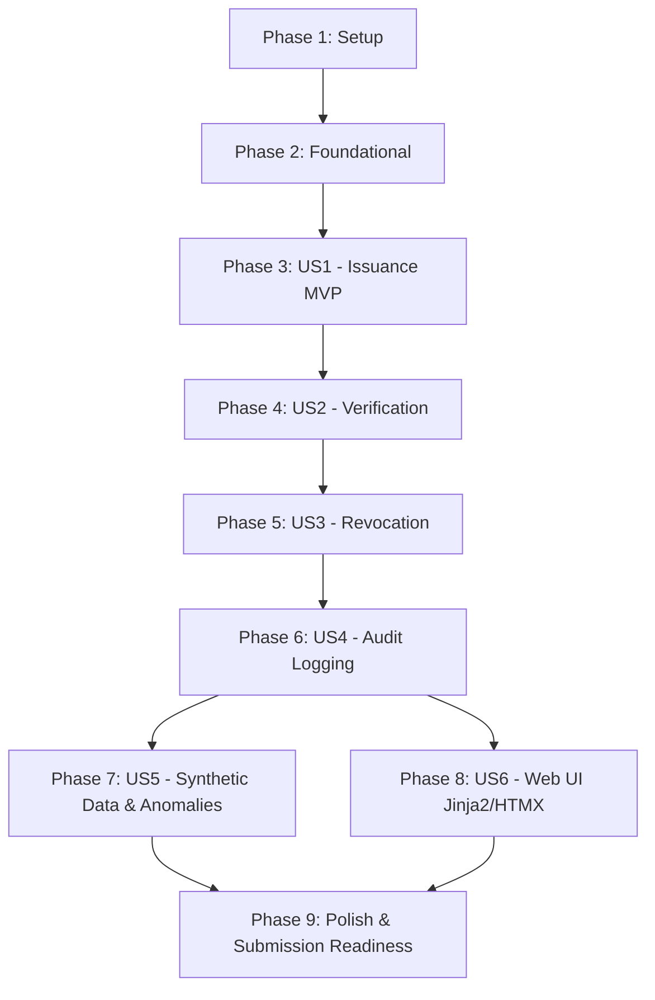

# Tasks: Digital Credential Lifecycle Management System

**Feature**: `specs/001-credential-lifecycle-system`  
**Spec**: [spec.md](spec.md) | **Plan**: [plan.md](plan.md)  
**Status**: Ready for Implementation  

---

## Phase 1: Setup (Shared Infrastructure)

**Purpose**: Project initialization, dependency management, and configuration.

- [X] T001 Create project directory tree (`src/core/`, `src/models/`, `src/schemas/`, `src/services/`, `src/generator/`, `src/api/`, `src/templates/`, `src/static/`, `tests/`) per implementation plan
- [X] T002 [P] Create `requirements.txt` with core dependencies (FastAPI, uvicorn, SQLAlchemy 2.0, asyncpg, psycopg2-binary, alembic, pydantic, pydantic-settings, jinja2, cryptography, faker, pytest, httpx)
- [X] T003 [P] Configure application settings in `src/core/config.py` using Pydantic `BaseSettings` (`DATABASE_URL`, `SECRET_KEY`, `APP_ENV`, `DEFAULT_SEED`)

---

## Phase 2: Foundational (Blocking Prerequisites)

**Purpose**: Core database, migration framework, and cryptographic foundations that MUST be complete before ANY user story can be implemented.

**⚠️ CRITICAL**: No user story work can begin until this phase is complete.

- [X] T004 Setup database connection and session management in `src/core/database.py` (SQLAlchemy async and sync engine/session makers, DeclarativeBase)
- [X] T005 Initialize Alembic migration environment in `alembic/` and configure `alembic/env.py` to target SQLAlchemy models
- [X] T006 [P] Implement cryptographic security primitives in `src/core/security.py` (Canonical JSON serialization, SHA-256 payload hashing, Ed25519 key generation, message signing, and signature verification)
- [X] T007 [P] Implement core exception handlers and structured error responses in `src/core/exceptions.py`
- [X] T008 Setup FastAPI application factory, static file mounting, Jinja2 template engine, and CORS in `src/main.py`

**Checkpoint**: Foundation ready — database connection, migration scaffold, and cryptographic primitives operational.

---

## Phase 3: User Story 1 — Core Eligibility Evaluation & Atomic Issuance (Priority: P1) 🎯 MVP

**Goal**: Evaluate course completion evidence against active credential rules and atomically issue authentic, tamper-evident credentials without duplicate issuance.

**Independent Test**: Verify by submitting completion records with scores above and below the 80% threshold, asserting that eligible records create unique credentials with canonical SHA-256 hashes and audit events in a single transaction, while ineligible records are cleanly rejected with zero state mutation.

### Tests for User Story 1
- [X] T009 [P] [US1] Unit test for canonical payload hashing and Ed25519 signing in `tests/test_security.py`
- [X] T010 [P] [US1] Unit test for eligibility evaluation business rules and score boundary conditions in `tests/test_eligibility.py`
- [X] T011 [P] [US1] Integration test for atomic issuance, audit logging, and duplicate issuance prevention in `tests/test_issuance.py`

### Implementation for User Story 1
- [X] T012 [P] [US1] Create ORM models for `Issuer` (`src/models/issuer.py`), `Course` (`src/models/course.py`), and `Learner` (`src/models/learner.py`)
- [X] T013 [P] [US1] Create ORM models for `CredentialRule` (`src/models/credential_rule.py`) and `CompletionRecord` (`src/models/completion.py`)
- [X] T014 [P] [US1] Create ORM model for `Credential` (`src/models/credential.py`) with unique constraint on `completion_id` and public ID index
- [X] T015 [P] [US1] Create Pydantic schemas for issuance request, eligibility evaluation, and credential response in `src/schemas/credential.py`
- [X] T016 [US1] Implement eligibility rule evaluation service in `src/services/eligibility.py`
- [X] T017 [US1] Implement atomic credential issuance service in `src/services/issuance.py` (canonical payload construction, SHA-256 hashing, Ed25519 signing, atomic DB commit)
- [X] T018 [US1] Implement REST API endpoints in `src/api/v1/issuance.py` (`POST /api/v1/issuance/evaluate`, `POST /api/v1/issuance/issue`)
- [X] T019 [US1] Generate and apply initial Alembic migration for US1 tables (`alembic revision --autogenerate`, `alembic upgrade head`)

**Checkpoint**: User Story 1 fully functional and testable independently. Core issuance vertical slice working.

---

## Phase 4: User Story 2 — Third-Party Verification with Multi-Factor Integrity (Priority: P1)

**Goal**: Provide an unauthenticated public verification service that independently checks payload integrity, issuer authenticity, and live revocation status, ensuring a hash alone is never presented as proof of authenticity.

**Independent Test**: Query verification service with valid IDs, altered payloads (tampered score), and non-existent IDs. Assert return of `VALID`, `TAMPERED`, or `NOT_FOUND` with 100% precision.

### Tests for User Story 2
- [X] T020 [P] [US2] Unit test for multi-factor verification logic (hash integrity vs signature authenticity) in `tests/test_verification.py`
- [X] T021 [P] [US2] Integration test for public verification REST API endpoint in `tests/test_verification.py`

### Implementation for User Story 2
- [X] T022 [P] [US2] Create ORM model for `VerificationRequest` in `src/models/verification.py`
- [X] T023 [P] [US2] Create Pydantic schemas for verification queries and detailed result representations in `src/schemas/verification.py`
- [X] T024 [US2] Implement multi-factor verification service in `src/services/verification.py` (evaluates existence, SHA-256 payload integrity, Ed25519 issuer signature, and revocation state; logs verification attempt)
- [X] T025 [US2] Implement public verification REST endpoint in `src/api/v1/verification.py` (`POST /api/v1/verification/verify`)
- [X] T026 [US2] Generate and apply Alembic migration for `verification_requests` table

**Checkpoint**: User Stories 1 AND 2 working independently. Credentials can be both issued and verified.

---

## Phase 5: User Story 3 — Authorized Revocation with Live Reflection (Priority: P2)

**Goal**: Enable authorized administrators to revoke credentials with reason codes, ensuring immediate reflection in verification while preserving historical records and audit logs.

**Independent Test**: Revoke an active credential, verify creation of `Revocation` record, and assert that subsequent verification requests immediately return status `REVOKED` without mutating original issuance data.

### Tests for User Story 3
- [X] T027 [P] [US3] Unit test for revocation service, reason code validation, and idempotency in `tests/test_revocation.py`
- [X] T028 [P] [US3] Integration test verifying that revoked credentials immediately return `REVOKED` on verification in `tests/test_revocation.py`

### Implementation for User Story 3
- [X] T029 [P] [US3] Create ORM model for `Revocation` in `src/models/revocation.py` with foreign key to `credentials` and unique constraint
- [X] T030 [P] [US3] Create Pydantic schemas for revocation request and response in `src/schemas/revocation.py`
- [X] T031 [US3] Implement revocation service in `src/services/revocation.py` (records revocation, transitions credential status to `REVOKED`, appends audit event)
- [X] T032 [US3] Implement administrative revocation REST endpoint in `src/api/v1/revocation.py` (`POST /api/v1/revocation/revoke`)
- [X] T033 [US3] Generate and apply Alembic migration for `revocations` table

**Checkpoint**: Complete credential lifecycle (Issuance -> Verification -> Revocation -> Live Verification) fully functional.

---

## Phase 6: User Story 4 — Comprehensive Append-Only Audit History (Priority: P3)

**Goal**: Maintain a tamper-resistant, append-only operational log of all lifecycle transitions (issuance, revocation, verification, administrative exceptions).

**Independent Test**: Execute full lifecycle sequence, query audit log, and assert exact sequential event reconstruction. Verify application rejects any update or delete operations on audit records.

### Tests for User Story 4
- [X] T034 [P] [US4] Integration test for append-only audit event recording and query filtering in `tests/test_audit.py`

### Implementation for User Story 4
- [X] T035 [P] [US4] Create ORM model for `AuditEvent` in `src/models/audit.py` with JSONB details and indexed target fields
- [X] T036 [P] [US4] Create Pydantic schemas for audit query parameters and event responses in `src/schemas/audit.py`
- [X] T037 [US4] Implement centralized audit logging service in `src/services/audit.py`
- [X] T038 [US4] Implement audit query REST endpoint in `src/api/v1/audit.py` (`GET /api/v1/audit/events`)
- [X] T039 [US4] Generate and apply Alembic migration for `audit_events` table

**Checkpoint**: Audit logging active across all operations. Complete data layer and API operational.

---

## Phase 7: User Story 5 — Reproducible Synthetic Data Generation & 4 Anomalies (Priority: P2)

**Goal**: Deterministically generate baseline dataset (20,000 learners, 1,000 courses, 10,000 credentials, 5,000 verifications) from seed `42` within 60 seconds, with 4 demonstrable anomaly fixtures evaluated against segregated ground truth.

**Independent Test**: Run generator twice with seed `42`, assert identical SHA-256 checksums across CSV/JSON/SQL exports, and evaluate the 4 anomalies against ground truth.

### Tests for User Story 5
- [X] T040 [P] [US5] Unit test for generator seed determinism and checksum repeatability in `tests/test_generator_determinism.py`
- [X] T041 [P] [US5] Evaluation test verifying all 4 anomaly scenarios against segregated ground truth in `tests/test_anomalies.py`

### Implementation for User Story 5
- [X] T042 [US5] Implement PRNG-seeded entity generators in `src/generator/generator.py` (`issuers`, `courses`, `rules`, `learners`, `completions`, `credentials`, `verifications`, `audits`) in strict topological order
- [X] T043 [US5] Implement high-performance bulk insertion using SQLAlchemy Core batch inserts in `src/generator/db_loader.py`
- [X] T044 [US5] Implement the four mandatory anomaly fixture generators in `src/generator/anomalies.py` (Premature Issuance, Duplicate ID, Stale Revocation Verification, Altered Payload) with independent ground-truth JSON labeling
- [X] T045 [US5] Implement CSV, JSON, and SQL export engine with SHA-256 digest manifest generation in `src/generator/exporter.py`
- [X] T046 [US5] Implement CLI interface in `src/generator/cli.py` (`python -m src.generator.cli --seed 20261022 --scale 1.0 --output-dir ./exports`)
- [X] T047 [US5] Implement dataset validation script in `src/generator/validator.py` (validating PK/FK referential integrity and date ordering)

**Checkpoint**: Full-scale synthetic data pipeline verified with seed repeatability and anomaly fixtures.

---

## Phase 8: User Story 6 — Web Interface Demonstration (FastAPI + Jinja2 + HTMX) (Priority: P3)

**Goal**: Deliver a responsive, interactive demonstration interface served directly by FastAPI using Jinja2 templates and HTMX, adapted from Google Stitch visual prototypes.

**Independent Test**: Open browser, enter credential ID, observe real-time HTMX verification badge response (<200ms) without page reload, and execute administrative revocation flow.

### Implementation for User Story 6
- [ ] T048 [P] [US6] Create master Jinja2 layout shell in `src/templates/base.html` (Inter typography, HTMX inclusion, header/nav, toast container)
- [ ] T049 [P] [US6] Create custom CSS stylesheet in `src/static/css/styles.css` adapting Google Stitch visual design references
- [ ] T050 [US6] Create public verification page in `src/templates/pages/verify.html` and HTMX partial `src/templates/partials/verification_badge.html`
- [ ] T051 [US6] Create administrative credential management table in `src/templates/pages/credentials.html` and revocation modal partial `src/templates/partials/revocation_modal.html`
- [ ] T052 [US6] Create audit log exploration view in `src/templates/pages/audit.html`
- [ ] T053 [US6] Implement FastAPI web route handlers in `src/api/views/web.py` supporting both full page loads and `HX-Request` partial swaps
- [ ] T054 [US6] Validate live interactive UI workflows in running application

**Checkpoint**: Complete user interface active, interactive, and connected to working backend services.

---

## Phase 9: Polish, Cross-Cutting Concerns & Submission Readiness

**Purpose**: Verification evidence, documentation updates, export manifests, and submission packaging.

- [ ] T055 [P] Run full test suite and update verification evidence in `docs/TEST_EVIDENCE.md`
- [ ] T056 [P] Update `docs/STATUS.md` and `docs/DECISIONS.md` reflecting completed milestones
- [ ] T057 Verify end-to-end execution of `quickstart.md` commands from a clean environment
- [ ] T058 Update `README.md` with final walkthrough instructions, demo script, and evaluation evidence
- [ ] T059 Perform final audit against `MASTER_SPEC.md` and Constitution v1.1.0 before submission

---

## Dependencies & Execution Order

---

## Parallel Execution Opportunities

- **Phase 1 (Setup)**: T002 (`requirements.txt`) and T003 (`config.py`) can be built in parallel.
- **Phase 2 (Foundational)**: T006 (`security.py`) and T007 (`exceptions.py`) can be developed in parallel.
- **Phase 3 (US1)**: Models T012, T013, T014 can be developed in parallel; Tests T009, T010, T011 can be written concurrently.
- **Phase 7 & 8 (Synthetic Data & UI)**: Once core backend lifecycle (Phases 3-6) is complete, synthetic data generation (Phase 7) and Jinja2/HTMX frontend integration (Phase 8) can proceed in parallel.
